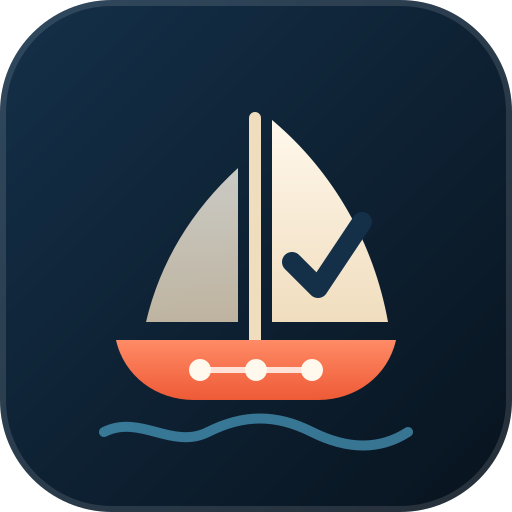

<p align="center">
  
</p>

<h1 align="center">shipshape</h1>

<p align="center"><b>Make your coding agent work like a professional engineering team, and learn why as it goes.</b><br>
Claude Code · Codex · Cursor · GitHub Copilot · Gemini CLI · Google Antigravity · Windsurf · any agent that reads <a href="https://agentskills.io">Agent Skills</a></p>

---

AI coding agents can build real products, but left alone they "vibe code". They forget what the last session did.
They guess how the code connects. They commit straight to `main`, test against fakes, and change things that were
decided on purpose. Strong software teams avoid this with a few cheap habits built into their tools. **shipshape
brings those habits into every session, in any agent.** It scales the process to the risk, so a typo stays a typo,
and it explains each habit the first few times, so you learn the craft instead of only following rules.

## What it does

| | |
|---|---|
| 🧠 **Never forgets** | Every project gets a memory: `docs/STATUS.md` (where we are, what's next), `DECISIONS.md` (numbered decisions with the *why*), `ARCHITECTURE.md` (how the code connects) and `CHANGELOG.md`. They are built from the real code the first time, loaded at every session start and kept current with every change. A git hook rejects code commits that leave them stale. |
| 🔎 **Never codes on guesses** | Before the first edit, the agent tells you where the project stands, which decisions apply, and which files and callers it will touch. It reads that code before changing it. If the docs and the code disagree, the code wins and the docs get fixed. |
| ⚖️ **Ceremony by risk** | **T0** trivial: a branch and a commit. **T1** normal: a plan that names its check, tests on the real code path, a diff review and a PR. **T2** risky (data, auth, money, deletes, live systems): a written plan, your go-ahead, a fresh-eyes review, a dry run first and a rollback. |
| 🌿 **Branches and PRs, even solo** | It never commits to `main`. It asks at session start if it finds itself there. Every change lands as a PR with What / Why / How verified / Risk. |
| 🧪 **Tests that test the real thing** | At least one test runs the real function, not only a fake. This rule comes from a real incident: the fakes passed while the real upload crashed live. |
| 🚦 **Safe live changes** | Checks what's in flight, uses a dry run or staging first, writes a backup and rollback, and watches the system afterwards. |
| 🌙 **Unattended mode** | "Do X, I'm going to sleep." The agent works on its own branch and runs the checks. It opens a PR, or stops and explains why, and leaves a report you can read on a phone in two minutes. It never merges and never touches anything live or secret. |
| 🎓 **Teaches as it goes** | Three levels: `learning` (full explanations and check questions), `working` (one short "why" the first time, the default), `quiet` (no teaching). Explanations fade as you learn them. |

## Install

**Claude Code (full experience: skills + session hooks + reviewer agent)**

```bash
claude plugin marketplace add Ahsuu27488/shipshape
claude plugin install shipshape@shipshape
```

It's installed for all your projects (user scope). Settings live in `/config`: teaching level, the main-branch guard, and whether memory setup asks first or just happens (`auto_setup`).

**Any other agent (Codex, Cursor, Copilot, Gemini CLI, Antigravity, Windsurf, and 40+ more)**

```bash
gh skill install Ahsuu27488/shipshape --all --scope user --agent <your-agent>
```

This uses GitHub CLI 2.90 or later. Agent IDs include `codex`, `cursor`, `github-copilot`, `gemini-cli`, `antigravity` and `windsurf`.
Alternatives: `npx skills add Ahsuu27488/shipshape -a '*' -g`, `gemini skills install https://github.com/Ahsuu27488/shipshape`,
or copy `skills/*` into your repo's `.agents/skills/` (read by Codex, Cursor, Copilot, Gemini CLI and Antigravity)
and commit it, so your whole team gets it.

## Start using it

- **Existing project:** ask your agent to *"set this project up with shipshape"*. It surveys the code, builds the memory
  docs from what is really there, adds the rules and hooks, and opens a PR for you to review.
- **New project:** open an empty folder and describe what you want. The first step sets up git, the memory docs,
  hooks and CI, and then builds your feature on a branch.
- **Every day:** just work. The memory loads at session start, and changes follow the tiers.
- **Overnight:** `tools/shipshape-run.sh --agent claude "add CSV export to the reports page"`, or just tell your agent
  "run this unattended". You'll get a PR and a report.
- **"How healthy is my repo?"** → `shipshape-checkup`. **"What did you just change?"** → `shipshape-explain`.

## What it changes in your repository

Only through a pull request you review (`shipshape-adopt`). It never overwrites a file you already have; it merges:

| File | Purpose |
|---|---|
| `docs/STATUS.md`, `DECISIONS.md`, `ARCHITECTURE.md`, `CHANGELOG.md`, `docs/plans/` | The project's memory |
| `AGENTS.md` (a marked block), `CLAUDE.md`, `GEMINI.md` | Make every agent load the memory and the rules |
| `.shipshape/config` | Your code folders, check commands, default branch and live commands |
| `.shipshape/context.sh` / `.ps1` | The session report: branch, recent commits, uncommitted work, unpushed commits, stale docs |
| `.githooks/commit-msg`, `pre-commit`, `pre-push` | Code needs docs; no commits on main; no secrets; main changes only through PRs. Turned on with `git config core.hooksPath .githooks` |
| `.github/workflows/ci.yml`, `.github/pull_request_template.md` | Checks and the docs gate on every PR |

The hooks and CI enforce the rules for **every** agent and every human, even ones without shipshape installed.

## Unattended runs

```bash
tools/shipshape-run.sh --agent codex --budget-min 60 "add rate limiting to the login endpoint"
```

`shipshape-run` creates a worktree on `auto/<date>-<slug>` and starts the agent headless with the unattended rules.
It enforces the time budget, then **re-runs your checks itself** (the agent doesn't grade its own work). It pushes,
and opens a draft PR, which becomes ready for review only if everything passed. The PR body is the report:
result, what changed, how it was verified, what wasn't done, risks, and which files to read first. Agents: `claude`, `codex`,
`gemini`, `agy`, `cursor`, `copilot`. Risky work (deletes, migrations, anything live) is never done unattended:
the agent writes the plan and stops for you. On Windows, use `tools\shipshape-run.ps1`.

## What runs and what is sent

- **No network calls of its own.** shipshape is Markdown instructions plus small shell scripts. Nothing is sent anywhere.
- The Claude Code plugin runs three local hooks: `scripts/session-start.sh` (prints the project state and memory into
  the session), `scripts/guard-bash.sh` (asks before commits/pushes on main, destructive commands and your configured
  live commands; denies them in unattended runs), and `scripts/guard-files.sh` (blocks secret files in unattended runs).
- `git`, `gh` and your project's own check commands run only as part of the workflow you asked for. `shipshape-run`
  pushes a branch and opens a PR with `gh` when you start it.
- Details: [PRIVACY.md](PRIVACY.md).

## Compatibility

Every release is tested on real agents, against a fixture project, by [`compat/`](compat/). The matrix with dates and versions is in
[compat/RESULTS.md](compat/RESULTS.md). The tests cover the memory recall, respecting a recorded decision, T0 without
ceremony, a feature on a branch with docs, adopting a repo, and stopping on risky unattended work.

## Works with

- **superpowers, `/code-review`, other workflow plugins:** shipshape adds the memory, tiers, teaching and repo
  setup, and defers to project-level rules and skills (for example your own `/checkpoint`).
- **Claude Code's Learning / Explanatory styles:** those teach the code; shipshape teaches the engineering process.

## FAQ

**Isn't this overkill for a typo?** No. A typo is T0: a branch and a commit, nothing else.
**I work alone. Why PRs?** A PR is the undo button, the record of why, and where CI runs. You merge your own.
**My hosting plan can't protect `main`.** The `pre-push` hook guards it locally, and the agent's guard asks first.
**Does it work without git?** It sets git up for you in a new project. The memory docs alone help any agent.

## Contributing, security, license

[CONTRIBUTING.md](CONTRIBUTING.md) · [SECURITY.md](SECURITY.md) · [MIT License](LICENSE) · made by
[Muhammad Ahsan](https://github.com/Ahsuu27488), who also made [Foreman](https://github.com/Ahsuu27488/foreman).
